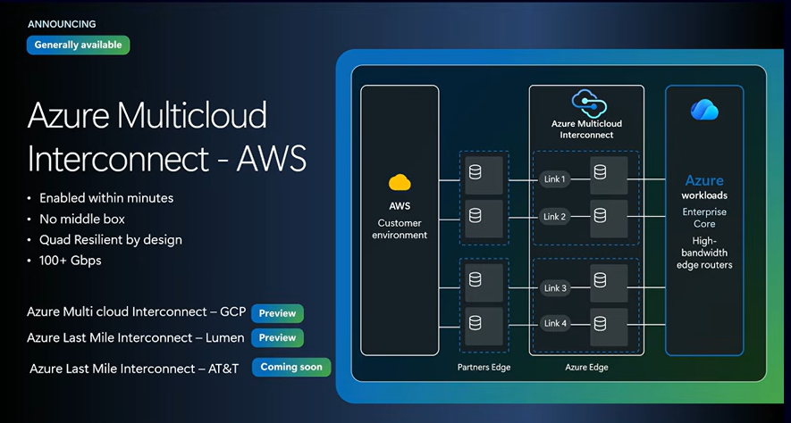
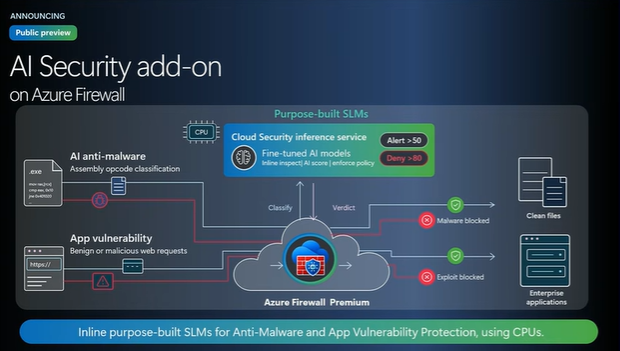

# Microsoft Ignite 2026 Azure Networking レポート

## How Azure Networking is ready for the next generation of AI solutions

- **セッションID：** BRK433
- **登壇者：** Igor Sakhnov、Lucas Satzinger Gomes、Narayan Annamalai
- **公式動画：** [Microsoft Events 公開動画](https://www.youtube.com/watch?v=DsJUyF4Ep48)（43分53秒、2026年11月18日公開）
- **確認日：** 2026年11月19日

本レポートは筆者がセッションを視聴したメモからAIによる補足情報を追記し整理したものである。個人的に注目したトピックに★をつけている。

## 要点

**Azure Networking の方向性は、AIを支える通信基盤の刷新、AIによる運用自動化、AIエージェントの通信を制御するセキュリティの3本柱。** 帯域や遅延の改善に加え、分散するモデル・データ・エージェントを接続し、その通信を継続的に管理する役割が強調された。

## 1. 通信基盤の刷新と運用自動化

- **AI向けのネットワーク設計：** GPU・計算ノード・ストレージ間の東西通信に対応するため、データセンター内の構成をフラット化。中空コア光ファイバーによる遅延低減や、リージョン外のGPU拠点をAzureネットワークへ接続する方向性も紹介された。
- **AIによる運用：** 光ファイバー障害対応エージェント「Miles」が、障害箇所の特定、修理業者との調整、必要時の人へのエスカレーション、復旧確認を担当する事例を紹介。物理的な修理は人が行い、連絡・調整などの反復作業をAIが担う。

## 2. Banco Santander の導入事例

**地域・銀行ごとに分かれていた基盤を、共通設計のグローバルなクラウド基盤へ統合。** Azure Virtual Network Managerによる接続・ポリシー管理、プライベート接続、DNS、監視を組み合わせ、事業やワークロードが増えても運用の複雑さを抑える設計を説明した。

AI支援運用では、Azure SRE Agentの活用に取り組み、Foundryを使った自社向け運用支援を次の段階として位置付けている。エンジニアの管理下で原因調査と反復作業を効率化する考え方が示された。[18:15〜23:43](https://www.youtube.com/watch?v=DsJUyF4Ep48&t=1095s)

## 3. 接続とネットワーク管理の主な更新

提供状況は確認日時点の公式情報とセッション発表に基づく。

| 機能 | 提供状況 | ポイント |
| --- | --- | --- |
| [Azure Multicloud Interconnect](https://techcommunity.microsoft.com/blog/AzureNetworkingBlog/connecting-clouds-and-the-last-mile-with-azure/4573283) | AWS接続は一般提供、Google Cloud接続はパブリックプレビュー | クラウド間のプライベート接続を統合された手順で構築。基盤の冗長化とプロバイダー間の運用調整をサービス側で担う |
| [IPv6-only VNet peering](https://learn.microsoft.com/en-us/azure/virtual-network/virtual-network-peering-overview) | パブリックプレビュー | 各VNet内でIPv4アドレス空間を再利用し、デュアルスタックVNet間の通信には重複しないIPv6アドレスを使用する |
| [Azure Route Server の Route Maps](https://techcommunity.microsoft.com/blog/azurenetworkingblog/route-summarization-in-azure-route-server/4569901) | セッションでは一般提供と説明※ | 経路の集約・フィルタリング、AS-PATHの変更などにより、ハイブリッド環境の経路制御を簡素化 |
| [Azure Kubernetes Fleet Manager のクロスクラスター接続](https://techcommunity.microsoft.com/blog/azurenetworkingblog/what%E2%80%99s-new-in-aks-networking-connectivity-performance-and-observability/4571806) | 一般提供 | 複数AKSクラスター間の接続・サービス検出・ネットワークポリシーを統合し、接続用ゲートウェイなどの管理負担を軽減 |

### ★Azure Multicloud Interconnect
マルチクラウドを閉域で接続する場合は、今後選択肢に入ってきそう。オンプレと接続する場合はExpressRouteが必要。

https://learn.microsoft.com/ja-jp/azure/multicloud-interconnect/overview

## 4. AIによる監査と脆弱性対策

### ★Azure Bastion のAI支援監査

**RDP vision、SSH vision、SSH command logsをパブリックプレビューとして紹介。** Bastion Premiumの録画をAIが要約・分析し、調査すべき操作を見つけやすくする。SSHではコマンドログも利用でき、担当者は録画・ログと照合して判断する。Bastionを利用するなら便利そう。[公式発表](https://techcommunity.microsoft.com/blog/azurenetworkingblog/from-recordings-to-insights-azure-bastion-brings-ai-to-privileged-session-review/4573409)

### ★Azure Adaptive Virtual Patching

**正式な修正パッチを適用するまでの間、ネットワークと実行時の制御で脆弱性の悪用を抑える機能。** セッションではパブリックプレビューと説明された。公式発表ではAzure上のLinux VMとVirtual Machine Scale Setsから対応を開始し、脆弱性情報とワークロードの状態に応じて緩和策を適用する。ソフトウェアの正式な修正パッチは、通常の手順で別途適用する。[公式発表](https://techcommunity.microsoft.com/blog/azurenetworkingblog/the-patch-window-is-closing-put-time-back-on-the-defender%E2%80%99s-side-/4573402)

**デモでは、Ubuntu上のApacheに対するHTTP/2の攻撃でメモリ使用率が増加する状態を再現。** 対象VMを登録し、推奨された緩和策を承認・適用すると、同じ攻撃を再実行してもメモリ使用率が増加しない様子が示された。

## 5. AIアプリケーションとエージェントの通信制御

### Application Gateway for Containers のAI対応

**推論先の負荷やKVキャッシュを考慮し、リクエストの振り分けを最適化する機能をパブリックプレビューとして紹介。** llm-dなどと連携し、最初のトークンが返るまでの時間（TTFT）の短縮とGPUの効率的な利用を目指す。公式仕様では、クラスター側のEndpoint Pickerがモデルサーバーの選択を担う。[Inference gatewayの公式仕様](https://learn.microsoft.com/en-us/azure/application-gateway/for-containers/inference-gateway)

セッションでは、MCPの複数ツールへのアクセスを単一URLに集約し、ログ収集や保護をまとめる機能も説明された。

AKSでAIを独自運用する場合に使用すると便利そうなサービスだった。

### ★Azure Firewall Premium のAIセキュリティ拡張

既存のPremiumに追加するAIアドオンを、パブリックプレビューとして紹介した。小型モデルによるマルウェア・アプリケーション攻撃のインライン検査に加え、Microsoft Purviewによるデータ損失防止（DLP）、Azure AI Content Safetyによるプロンプトインジェクション対策を組み合わせる。

公式発表では、プロンプト保護はまず直接的なプロンプトインジェクションを対象とし、外部文書などを経由する間接的な攻撃への対応は今後の計画としている。[Azure Firewallの公式発表](https://techcommunity.microsoft.com/blog/azurenetworkingblog/secure-ai-secure-with-ai-introducing-the-next-chapter-of-azure-firewall-/4573399)

★Azure Firewallのネットワーク層で、データ漏洩/マルウェア感染/脆弱性悪用/AIへの攻撃（プロンプトインジェクション）をAIモデルによって検知できる。今の時代のセキュリティ攻撃への対策への有効な一手になると感じた。

### Agent Grid

**エージェント自身の外側に通信の制御点を置き、IDに基づいて接続先や許可する操作を管理する。** プレビューでは、対応するACI・AKSの実行環境を対象に、ネットワーク分離、FQDN・URL制御、MCPツール単位の許可・拒否、コンテンツ検査などを提供する。

エージェントのコード変更や利用者側でのサイドカー管理を不要とし、管理者が共通のポリシーをネットワーク側で適用する。モデルやツールを呼び出せる能力と、実際に許可する権限を分けて管理する仕組みとして位置付けられた。[Agent Gridの公式発表](https://techcommunity.microsoft.com/blog/azurenetworkingblog/introducing-agent-grid/4573407)

## 設計・運用への示唆

本セッションからは、**AI基盤の拡張に合わせて、接続・経路・ポリシーを共通化し、運用へのAI導入とエージェントの権限制御を並行して進めることが重要**と読み取れる。既存のネットワーク管理を標準化したうえで、推論の振り分けや通信保護など、必要なプレビュー機能を個別に検証する進め方が考えられる。
